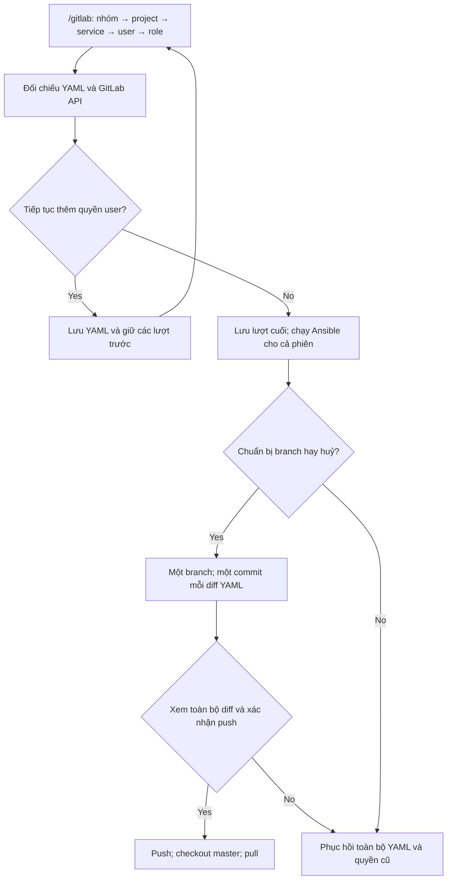

# Luồng /gitlab: gom nhiều lượt phân quyền

Tài liệu dựa trên source `master` tại commit `0ec4cea` của `tuanphi/infra-bot`.
`gitlab_conversation.py` giữ hội thoại; `gitlab_access.py` kiểm tra Git/YAML/API,
gom Ansible và tạo commit; `bot.py` đăng ký BotCommand. Bot chỉ push branch,
không tạo MR, không có luồng `/run` hoặc module cấu hình riêng.
Callback `ansible_callbacks/bot_timing.py` và quote HTML được giữ.

## Hội thoại và ý nghĩa Yes/No



1. `/gitlab` hiện ghub/non-ghub, **📁 Chọn project** và **📁 Chọn service**.
   Project là namespace trong YAML. Danh sách dùng nút, hai nút/hàng và tối đa
   12 lựa chọn/trang; phân trang dùng index, nonce và message ID.
2. Nhập username hoặc danh sách username, phân cách bằng dấu phẩy, khoảng trắng,
   xuống dòng. Mỗi lượt tối đa 50 user; role chung gồm maintainer/developer/reporter/guest.
3. Bot đọc API, hiển thị quote thông tin quyền và phân loại YAML/API.
4. Lượt cần sửa YAML gửi quote:

   ```text
   📝 Sẽ cập nhật YAML và chạy Ansible.
   ```

   Bot gửi menu riêng, không dùng câu hỏi cũ:

   ```text
   ❓ Bạn có muốn tiếp tục thêm quyền user
   
   ```

5. **Yes** lưu bản YAML đã chọn, giữ các snapshot trước, rồi mở lại menu
   ghub/non-ghub. Chưa chạy Ansible. Có thể chọn cùng hoặc khác nhóm,
   namespace, service và user; YAML của lượt sau có cả thay đổi các lượt trước.
6. **No** lưu lượt hiện tại và chạy Ansible cho toàn bộ phiên. Các lượt có cùng
   nhóm/namespace dùng một lần chạy với các service đã chọn. Lặp lại service
   không làm tăng số lần chạy; Ansible nhận bản YAML cuối cùng.
7. Ansible và xác minh API thành công: nếu có diff YAML thì hiển thị menu
   chuẩn bị branch/commit hoặc huỷ toàn bộ. Sau chuẩn bị, vẫn phải xem thông tin
   branch/difference và chọn Yes tại menu push mới đẩy branch.

| Menu | Yes | No |
| --- | --- | --- |
| Tiếp tục thêm quyền user | Giữ YAML, mở lượt mới | Dừng gom, chạy toàn bộ Ansible |
| Sau Ansible thành công | Chuẩn bị branch/commit local | Phục hồi YAML và quyền cũ |
| Xác nhận push | Push branch đã xem | Phục hồi YAML và quyền cũ |
| Ansible thất bại, có diff YAML | Chạy lại Ansible toàn bộ | Phục hồi YAML và quyền cũ |

`/cancle` và alias `/cancel` trước khi bắt đầu Ansible khôi phục YAML ban đầu
của tất cả các lượt đã gom, không chạy Ansible, không tạo commit/branch.
Sau khi bắt đầu Ansible, lệnh này báo chờ hoặc hiển thị lại menu quyết định.
`/gitlab` trong lúc gom mở lại menu, giữ các lượt đã lưu; bỏ phần lựa chọn mới
chưa được chấp nhận. `/reset` và user khác bị chặn khi phiên này giữ repo.

## Ví dụ hai lượt

Lượt 1: ghub → ghub-website → merchant-portal-client → tuanpv → developer → Yes.
YAML `group_vars/gitlab-ghub` được giữ, chưa chạy playbook.

Lượt 2: non-ghub → bankgateway → napas-operation → anhtn → developer → No.
YAML `group_vars/gitlab` được cập nhật; bot chạy cả ghub và non-ghub bằng
playbook tương ứng, sau đó chuẩn bị:

```text
bot-20261013-114536/Update-permission

gitlab-repo: Grant role developer for tuanpv to repo ghub-website/merchant-portal-client
gitlab-repo: Grant role developer for anhtn to repo bankgateway/napas-operation
```

Commit thứ nhất chứa đúng snapshot YAML của lượt 1. Commit thứ hai chứa đúng
thay đổi YAML của lượt 2; thay đổi thuộc lượt sau không đi vào commit trước.
Hai commit đều trên cùng branch. Difference trước push bao gồm cả hai file.

## Ba trường hợp YAML/API

| YAML | GitLab API | Xử lý |
| --- | --- | --- |
| Đúng role | Đúng role | Chưa có lượt trước: ✅ đã có quyền, kết thúc. Đang gom: báo ✅, giữ các lượt trước và hỏi thêm hay chạy. |
| Đúng role | Khác role hoặc chưa có membership | `sync`: gom yêu cầu chạy playbook, đọc lại API xác nhận; không commit cho lượt này. |
| Cần sửa | Bất kỳ role | `update`: lưu snapshot mới, chạy Ansible khi No, tạo một commit riêng sau khi thành công. |

Nếu tất cả các lượt chỉ `sync`/`unchanged`, phiên kết thúc sau đồng bộ/xác minh,
không branch/commit/push. Lượt có nhiều username vẫn chỉ tạo một commit nếu YAML
đổi. Lượt không đổi YAML không tạo commit rỗng.

Các yêu cầu liên tiếp cho cùng user/project áp dụng theo YAML cuối cùng. Nếu
lượt sau đổi role, role sau là giá trị cần xác minh cho một yêu cầu sync trước.
Mỗi lần YAML thực sự đổi vẫn có snapshot/commit riêng, kể cả hai thay đổi cuối
cùng đưa YAML về trạng thái ban đầu; trường hợp này xem từng commit khi diff
cuối cùng rỗng.

API role lấy từ `users?username=...` và `projects/<project-path>/members/all/<user-id>`.
Project path đầy đủ đọc từ service trong YAML, ví dụ
`development/ghub-website/merchant-portal-client`. Membership kế thừa được tính
trong API `members/all`; membership 404 được kiểm tra lại project để phân biệt
chưa có quyền và project không truy cập được.

| access_level | Role |
| ---: | --- |
| 10 | guest |
| 15 | planner (API nếu hỗ trợ) |
| 20 | reporter |
| 30 | developer |
| 40 | maintainer |
| 50 | owner |

User ID được đọc lại trước khi chạy hoặc phục hồi quyền, để chặn user đã thay
identity từ khi xem thông tin. API lỗi/không tìm thấy user không tạo lượt mới;
các lượt trước vẫn được giữ. API sau sync không khớp role thì báo ❌ và không
báo đã đồng bộ thành công.

## Ansible và file biến tạm

| Nhóm | YAML chính | Playbook của /gitlab |
| --- | --- | --- |
| ghub | `group_vars/gitlab-ghub` | `gitlab-repos-ghub.yaml` |
| non-ghub | `group_vars/gitlab` | `gitlab-repos.yaml` |

```bash
ansible-playbook -i nonprod <playbook> --tags=<namespace>,project_user_access --extra-vars=@group_vars/gitlab-bot
```

`run_batch()` gom theo `(repo_kind, namespace)`, lọc đúng tập service đã chọn.
Tất cả user/role mới của các service đó nằm trong bản YAML cuối cùng. Các biến
chung được giữ; `gitlab_groups` và `gitlab_projects` chỉ chứa namespace đang chạy.
Hai lượt cùng namespace, hai service: một playbook với hai project. Khác
namespace: hai playbook. Cùng service nhiều lượt: một project, một playbook.

`group_vars/gitlab-bot` có quyền 0600, không ghi đè file đã tồn tại, không commit
và được xoá sau success/failure/timeout. Env `ANSIBLE_HASH_BEHAVIOUR=replace`
ngăn inventory/vars_files gộp lại namespace ngoài phiên. Không dùng tags để
thay thế việc lọc dữ liệu vòng lặp: các tag chọn task theo quan hệ OR.

Runner trả PLAY RECAP, tổng thời gian, số project và tối đa 5 task chậm nhất
qua callback `bot_timing`. Mỗi lần chạy trong phiên có command/recap riêng.
Nếu một nhóm đã chạy thành công nhưng nhóm sau thất bại, bot giữ cả phiên để
retry hoặc phục hồi tất cả nhóm; không chuẩn bị branch khi Ansible chưa qua.

## Snapshot, khóa và kiểm tra Git

Phiên chứa danh sách `AppliedChange`: request, source YAML trước lượt, content
sau lượt và mode. Các request cùng dùng commit master ban đầu. Source của lượt
sau cho một file phải bằng content của lượt trước; vì vậy mọi thay đổi được nối
đúng thứ tự. `_batch_files()` lấy bản gốc và bản cuối của từng file.

Repo được khóa từ lần chấp nhận đầu tiên cho đến khi huỷ/đồng bộ/push hoàn tất,
kể cả thời gian người dùng chọn thêm lượt. Các check giữ những điều kiện:

- Lúc gom và chạy Ansible: cùng branch master, cùng HEAD ban đầu.
- Chỉ các file YAML đã ghi trong phiên được thay đổi, với đúng content đã chuẩn bị.
- Không có staged, file ngoài phiên hoặc symlink mới; dữ liệu lạ được giữ để kiểm tra.
- Sau commit: parent, đường dẫn file, blob YAML và commit message phải khớp snapshot.
- Trước push: tip branch và bản review phải khớp các commit đã chuẩn bị.

`batch_report()` gửi Git status và Git diff cho mọi file YAML của phiên.
`prepare()` nhận các lượt pending nên không yêu cầu repo sạch khi diff thuộc
đúng phiên; sửa ngoài phiên vẫn bị chặn. `/cancle` phục hồi từng file về bản gốc,
không ghi đè sửa ngoài phiên. Phiên giữ trong RAM, không tự phục hồi sau restart.
Startup vẫn dừng nếu checkout còn diff chưa hoàn tất. Chỉ dùng một replica.

## Branch và commit

| Số lượt đã chấp nhận | Branch |
| --- | --- |
| 1 | `bot-YYYYMMDD-HHMMSS/<namespace>/<service>` |
| Trên 1 | `bot-YYYYMMDD-HHMMSS/Update-permission` |

Thời gian dùng UTC+7 và `git check-ref-format --branch`; kiểm tra branch trùng
ở cả local/origin trước khi tạo. Lượt API-only không có branch khi cả phiên
không có diff YAML.

Mỗi `AppliedChange` ở mode `update` tạo một commit, đúng thứ tự:

```text
gitlab-repo: Grant role <role> for <user1>, <user2> to repo <namespace>/<service>
```

`prepare_branch()` tạm đặt snapshot của từng lượt vào file đang commit, dùng
`git commit --only -- <file>` để không đưa các lượt sau/file khác vào commit,
rồi đưa worktree về YAML cuối cùng. `Finalization.commits` ghi các commit đã
hoàn tất; khi retry, tiếp tục từ thay đổi chưa commit, giữ các commit cũ.

`branch_push_info()` kiểm tra toàn bộ chuỗi commit, trả diff tổng từ HEAD gốc
đến commit cuối, cùng danh sách commit/message. Trên branch nhiều lượt, message
hiển thị ID ngắn và tiêu đề của từng commit; cuối cùng vẫn hỏi:

```text
🚀 Bạn có muốn đẩy branch lên repo không?
✅ Yes: Push branch
❌ No: Huỷ thay đổi
```

Chỉ Yes tại menu này mới `git push --set-upstream origin <branch>`. Sau push,
`git checkout master` và `git pull --ff-only origin master`. Branch chứa các
commit YAML để người vận hành xử lý tiếp; bot không tạo hoặc merge MR.

## Huỷ sau Ansible hoặc sau chuẩn bị branch

No ở menu quyết định hoặc menu push gọi `_cancel_change()` cho toàn bộ phiên:

1. Kiểm tra worktree/HEAD và các snapshot đang thuộc phiên.
2. Nếu đang ở branch local, làm sạch các phần chưa commit theo snapshot HEAD,
   checkout master, giữ branch local đã chuẩn bị.
3. Khôi phục tất cả file YAML về source trước lượt đầu.
4. Kiểm tra identity, chạy lại toàn bộ nhóm/namespace/service đã chọn với YAML gốc.
5. Khi mọi playbook phục hồi thành công, checkout/pull master và nhả khóa.

Playbook phục hồi lỗi: chỉ retry No; YAML gốc và khóa vẫn được giữ. Nếu đã
phục hồi xong nhưng pull lỗi, retry chỉ hoàn tất checkout/pull. Đã xác nhận
push: không cho đổi sang No, chỉ retry Yes để hoàn tất. API/identity hoặc
Git đã đổi ngoài phiên làm bot dừng và giữ dữ liệu để kiểm tra.

## BotCommand, quote và startup

Menu đăng ký qua `post_init`: `/gitlab`, `/cancle`, `/reset`, `/help`; `/cancel`
là alias. `/whoami`, `/id`, `/start` vẫn có để chẩn đoán/hướng dẫn, không ở menu.
`config.py` đã bỏ; `main()` đọc `/mnt/secrets/.env` trực tiếp và dùng cấu hình
cần thiết của bot/Git/Ansible. Không thêm dependency mới.

`reply_full()` dùng HTML `<blockquote>` sau khi escape và chia theo tối đa 3500
đơn vị UTF-16. Git status/diff, thông tin quyền, Ansible/recap/timing, branch,
commit/difference, lỗi và kết quả hoàn tất đều là quote; menu nút là text thường.
Telegram lỗi sau Ansible thành công vẫn giữ trạng thái đã test, không bắt chạy
lại vì lỗi hiển thị; `/gitlab` có thể hiện lại menu.

`/reset` giữ menu nhóm/namespace, lấy master và chạy `gitlab-repos.yaml` cho cả
hai nhóm với `--extra-vars=@group_vars/gitlab-bot`; ghub đọc dữ liệu gitlab-ghub,
non-ghub đọc gitlab. Chạy toàn bộ project trong namespace; không gom vào phiên
`/gitlab`, không branch/commit/MR và bị chặn khi repo đang có phiên gom.

## Kiểm chứng

77 test đã qua trên Python 3.8.20, ansible-core 2.12.10, Jinja2 2.10.1:

- 47 test input/backend/hội thoại đơn và 19 test workflow/hội thoại gom lượt.
- 4 test BotCommand/quote, 2 test startup/branch.
- 5 test Ansible thật trên localhost: extra-vars, lọc namespace/service, callback,
  gom hai service cùng namespace và ghub/non-ghub.

```bash
python -m unittest discover -s tests -v
python -m py_compile bot.py git_auth.py runtime.py workflow.py gitlab_access.py gitlab_conversation.py ansible_callbacks/bot_timing.py
```

Git dùng repo bare tạm; API và Telegram được mô phỏng, không cấp quyền trên
GitLab nội bộ. Khi kiểm tra nội bộ, xác nhận:

1. Yes giữ YAML lượt 1, chưa có Ansible/commit/branch; lượt 2 nhìn thấy YAML mới.
2. No chạy đủ nhóm/namespace/service, giữ tất cả thay đổi vào một branch.
3. Một lượt giữ format branch cũ; nhiều lượt dùng Update-permission.
4. Mỗi diff YAML có commit riêng, đúng message/content và không lẫn lượt sau.
5. Preview chứa diff tất cả file và mọi commit; trước Yes push chưa có branch remote.
6. /cancle trong lúc gom chỉ phục hồi YAML; No sau Ansible phục hồi cả quyền.
7. Các trường hợp sync-only/đã có quyền không tạo commit; API sai phải báo lỗi.
8. Lỗi commit giữa chừng retry không lặp commit; lỗi Ansible không cho tạo branch
   trước khi test qua; nút cũ, user khác và /reset không làm mất phiên.